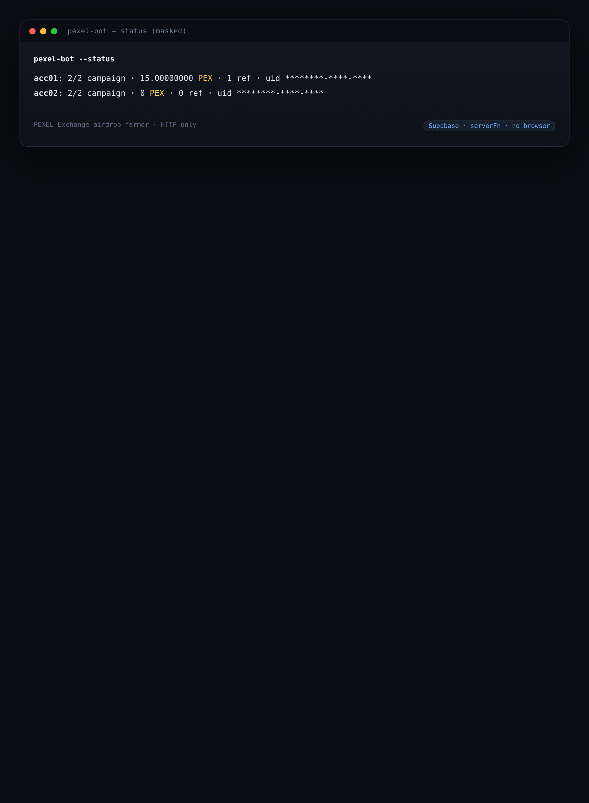

# pexel-bot



Farmer airdrop **PEXEL Exchange ($PEX)** — BEP20, pool 5.000.000 PEX. Satu perintah,
semua campaign gratis diklaim, tanpa modal, **tanpa browser**.

```
acc01: 2/2 campaign · 15.00000000 PEX · 1 ref
```

---

## Kenapa bot ini tanpa browser

Semua yang dibutuhkan airdrop PEXEL bisa diakses lewat HTTP biasa:

| Lapisan | Yang dipakai | Catatan |
|---|---|---|
| Auth | Supabase GoTrue (`/auth/v1/token`, `/verify`, `/factors`) | password grant → bearer token, TOTP didukung |
| Data | Supabase PostgREST (`/rest/v1/pex_airdrops`, `pex_airdrop_submissions`) | token user bisa baca campaign + riwayat sendiri |
| Aksi | TanStack server function `POST /_serverFn/<hash>` | header `x-tsr-serverFn: true`, body seroval |
| Captcha | **tidak ada** | signup, login, submit semuanya tanpa captcha |
| Cloudflare | tidak memblokir API | hanya halaman HTML yang di-cache |

Konsekuensi: satu run 2 akun selesai di bawah 3 detik, nol ketergantungan GPU/desktop,
dan tidak ada Chrome profile yang harus dirawat.

---

## Fitur

- **Auto-discover backend.** URL Supabase + publishable key dibaca ulang dari bundle
  frontend setiap 7 hari (`data/backend.json`). Kalau PEXEL redeploy, bot tidak mati —
  hash asset dan project ref-nya ikut berubah.
- **Login + MFA.** Password grant, lalu otomatis upgrade ke `aal2` pakai secret TOTP
  kalau akun punya authenticator. Tanpa TOTP pun tetap jalan selama server menerima `aal1`.
- **Registrasi + verifikasi email otomatis.** Signup → tunggu email → ambil `token_hash`
  dari Gmail lewat IMAP → `POST /auth/v1/verify`. Tidak perlu buka inbox manual.
- **Submit semua campaign aktif.** Campaign dibaca dari tabel, bukan di-hardcode, jadi
  campaign baru otomatis ikut dikerjakan run berikutnya.
- **Idempotent.** Campaign yang sudah pernah di-submit tidak dikirim ulang (API juga
  menolak duplikat). Cron harian aman dijalankan dua kali.
- **Humanisasi** (detail di bawah) — jeda, urutan acak, jitter, stagger antar akun.
- **Mode `--status`** read-only yang melewati semua jeda, jadi cek poin cuma hitungan detik.

---

## Kebutuhan

| Item | Versi / catatan |
|---|---|
| Python | 3.9+ (dites 3.14), **stdlib saja** — tanpa pip install |
| Node.js | 18+ — hanya untuk `tools/render-card.js` (screenshot) |
| Playwright | opsional, hanya untuk screenshot card |
| Gmail App Password | untuk verifikasi email otomatis (2FA Google harus aktif) |
| Akun PEXEL | 1 email = 1 akun (lihat bagian Batasan) |

---

## Instalasi

```bash
git clone <repo> pexel-bot && cd pexel-bot
cp config.json.example config.json
nano config.json          # isi akun + invite code + kredensial IMAP
chmod 600 config.json
```

`config.json` sudah masuk `.gitignore`. Jangan pernah commit isinya.

### Struktur config

```json
{
  "invite_code": "77710233",
  "humanize": {
    "min_gap_sec": 25, "max_gap_sec": 110, "long_pause_chance": 0.15,
    "account_stagger_sec": [40, 180], "run_jitter_sec": [0, 900]
  },
  "imap": {
    "host": "imap.gmail.com",
    "user": "akun@gmail.com",
    "password": "APP_PASSWORD_16_KARAKTER",
    "wait_sec": 120
  },
  "accounts": [
    {
      "label": "acc01",
      "email": "akun1@gmail.com",
      "password": "PASSWORD_AKUN_1",
      "invite_code": "77710233",
      "totp": "BASE32SECRETJIKAADA"
    }
  ]
}
```

- `invite_code` — kode referral milikmu (ada di halaman `/invite`). Dipakai saat mendaftarkan
  akun lain supaya bonus 15 PEX masuk ke akun utama.
- `totp` — secret authenticator (base32). Kosongkan kalau akun tidak pakai 2FA.
- `imap` — dipakai hanya oleh `--register`. Kalau semua akun sudah punya session tersimpan,
  blok ini boleh dibiarkan.

---

## Cara pakai

```bash
python3 src/main.py --discover          # baca ulang URL Supabase dari bundle
python3 src/main.py --status            # cek poin, referral, campaign terkirim
python3 src/main.py --daily             # submit semua campaign yang belum
python3 src/main.py --register --daily  # daftar akun baru + verifikasi email + submit
python3 src/main.py --daily --accounts acc01,acc02
python3 src/main.py --daily --no-jitter --limit 1   # uji cepat satu akun
```

Jalankan **tanpa** `--no-jitter` untuk produksi: itu yang memasang jitter start 0–15 menit,
stagger 40–180 detik antar akun, dan jeda 25–110 detik antar campaign.

### Output `--status`

```
$ python3 src/main.py --status
[1/2] acc01
[2/2] acc02

acc01: 2/2 campaign · 15.00000000 PEX · 1 ref · uid ********-****-****
acc02: 2/2 campaign · 0 PEX · 0 ref · uid ********-****-****
```

### Output `--daily`

```
acc01: 15.00000000 PEX · nothing new
```

Kalau ada campaign baru:

```
acc01: 45.00000000 PEX · PEXEL Community Airdrop: +25 PEX (pending)
```

---

## Humanisasi

Fleet safety bukan soal satu request valid atau tidak — semua request bisa balas 200 dan
akun tetap dianggap bot, karena **bentuk trafiknya** yang jadi sinyal: N akun mengerjakan
campaign yang sama, dengan urutan sama, di menit yang sama, dari satu IP.

| Primitif | Fungsi | Default |
|---|---|---|
| `run_jitter` | delay acak di awal proses biar cron 08:00 tidak nembak 08:00:00 | 0–900 s |
| `account_stagger` | jeda acak antar akun | 40–180 s |
| `mission_gap` | jeda antar campaign, dengan peluang pause panjang ("kena gangguan") | 25–110 s (+0–220) |
| `mission_order` | urutan task diacak tiap run | — |
| `honour_delay` | meniru timer 5 detik client-side antara buka link dan centang | 5 s + 1,5–7 s |

`honour_delay` itu penting walaupun server **tidak** memvalidasinya: bot yang submit dalam
0 detik setelah "buka" link adalah signature automasi paling jelas, dan menirunya nyaris
gratis.

Yang **tidak** dilakukan bot ini, dan alasannya:

- Tidak pakai proxy per akun. Untuk 30–45 PEX/akun, biaya proxy lebih besar dari nilai
  yang didapat. Kalau akun ditambah banyak, pasang proxy residensial per akun.
- Tidak memalsukan aktivitas X/Telegram. Platform **tidak** memeriksa apa pun (lihat
  bagian Batasan); menambah fake view/follow hanya menambah risiko akun sosial.

---

## Dukungan screenshot

```bash
python3 src/main.py --status > /dev/null      # menulis data/last-run.txt
node tools/render-card.js --input data/last-run-card.txt \
     --out docs/screenshots/run.png \
     --private-out docs/screenshots/private/run-full.png
```

Butuh playwright: `npm i playwright && npx playwright install chromium`, atau jalankan
dengan `NODE_PATH` menunjuk folder yang sudah punya playwright.

Versi publik (`run.png`) menyamarkan label akun jadi `acc01…` dan uid jadi bintang. Versi
penuh disimpan di `docs/screenshots/private/` yang masuk `.gitignore` — hanya di-commit ke
repo private dengan `git add -f`.

---

## Batasan yang harus diketahui

### 1 email = 1 akun

Registrasi PEXEL men-dedupe berdasarkan **email dasar**. Diuji 3 basis berbeda:

| Basis email | Hasil |
|---|---|
| `user+tag01@gmail.com` | sukses |
| `user+tag02@gmail.com` | ditolak `23505 Email already registered` |
| `userB+tagA@gmail.com` lalu `userB+tagB@gmail.com` | yang kedua ditolak |
| `userC+tagX@gmail.com` lalu `userC+tagY@gmail.com` | yang kedua ditolak |

Artinya alias `+tag` **tidak bisa** dipakai untuk farm banyak akun. Butuh N kotak masuk
Gmail asli untuk N akun.

### Task tidak diverifikasi server

Server hanya menerima daftar `taskIds` dari client. Tidak ada pengecekan keanggotaan
Telegram, tidak ada verifikasi follow/retweet X, tidak ada pengecekan isi tweet. Satu-satunya
gate adalah timer 5 detik di client, dan itu pun tidak divalidasi.

Konsekuensi jujur: siapa pun bisa klaim. Tapi status submit awal selalu `pending` dan
di-approve manual oleh admin — jadi submission yang jelas tidak manusiawi bisa ditolak
saat review. Bot ini meniru timing manusia untuk alasan itu.

### Token belum punya harga

Per 24 Nov 2026: PEX belum listing (DEXScreener `pairs: null`, GeckoTerminal 404), dompet
CEX Listing 10 juta PEX masih utuh. Jadi **nilai PEX saat ini nol** — yang dikumpulkan
adalah opsi, bukan pendapatan.

### Withdraw butuh 50 PEX

Minimal withdraw 50 PEX, fee 5 PEX, jaringan BEP20. Dua campaign utama menghasilkan
25 + 5 = 30 PEX, jadi butuh referral atau akumulasi beberapa campaign untuk bisa menarik.

---

## Troubleshooting

| Gejala | Sebab | Solusi |
|---|---|---|
| `serverFn 500: Seroval Error (step: 3)` | body request bukan envelope seroval, atau server function id berubah | jalankan `--discover`, lalu cek id di `src/api.py` |
| `login 400 invalid_credentials` | password berubah / akun belum diverifikasi | verifikasi email dulu, atau pakai `--register` |
| `no verification mail … within Ns` | email masuk ke folder lain, atau IMAP belum aktif | pastikan App Password valid dan 2FA Google aktif |
| `23505 Email already registered` | alias `+tag` dari email yang sudah terdaftar | pakai Gmail asli lain |
| `rest 403 permission denied` | token kedaluwarsa | bot otomatis login ulang; kalau tetap, hapus `data/accounts.json` untuk akun itu |
| screenshot gagal `playwright not found` | playwright belum ada di folder itu | `npm i playwright` atau set `NODE_PATH` |

---

## Struktur

```
pexel-bot/
├── src/
│   ├── api.py         # client HTTP: auth, PostgREST, server function, IMAP verify
│   ├── humanize.py    # semua primitif jeda/urutan/jitter
│   └── main.py        # CLI + report
├── tools/
│   └── render-card.js # screenshot card dari output asli
├── data/              # session, last-run.json/txt (gitignored)
├── docs/screenshots/  # run.png publik + private/ yang tidak di-commit
└── config.json.example
```

---

## Catatan hukum

Bot ini mengotomasi task yang syaratnya hanya "join channel / follow / retweet". Tidak ada
modal yang disetor, tidak ada wallet yang di-connect, tidak ada data pribadi yang dikirim.
Tetap: pakai akun milikmu sendiri, dan sadari bahwa program airdrop bisa mengubah aturan
atau membatalkan alokasi kapan saja.
